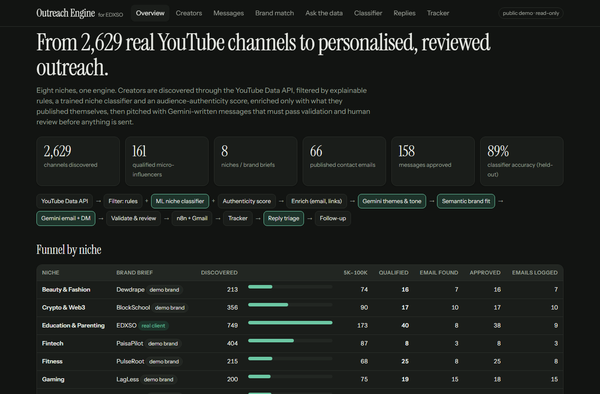
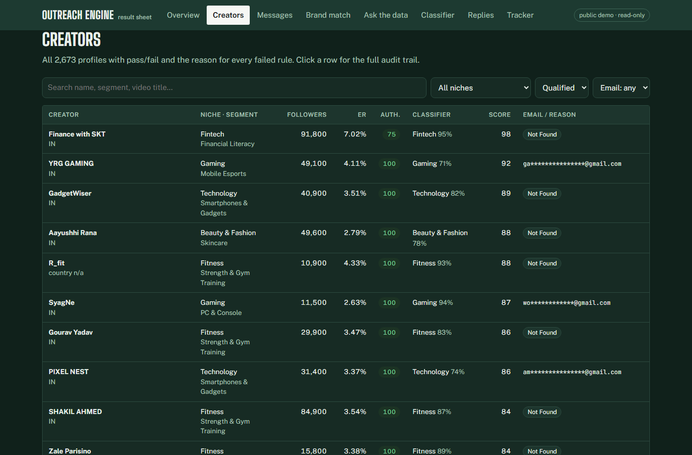
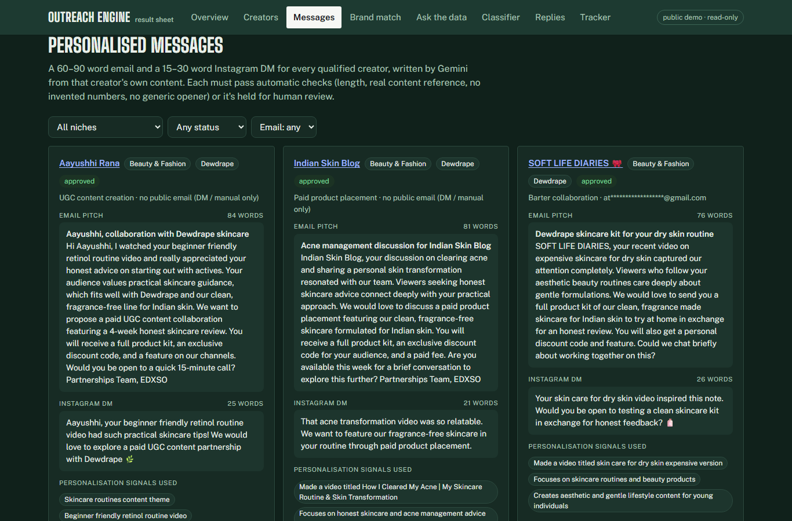
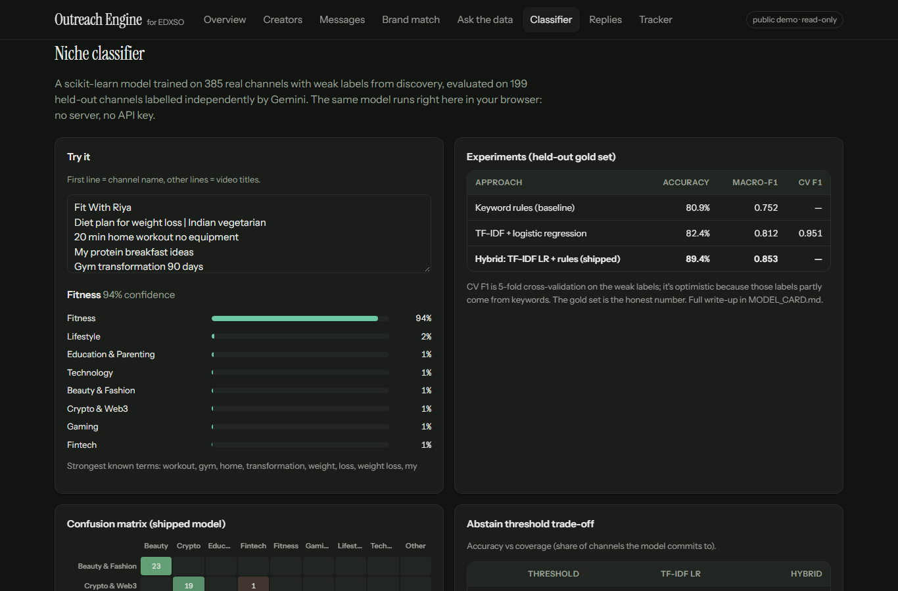
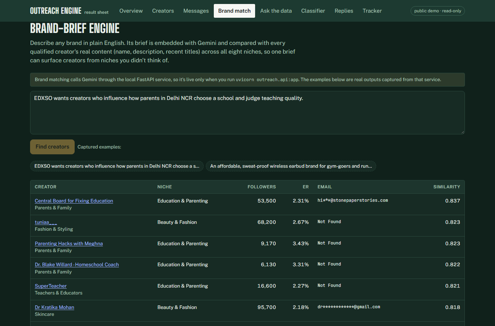
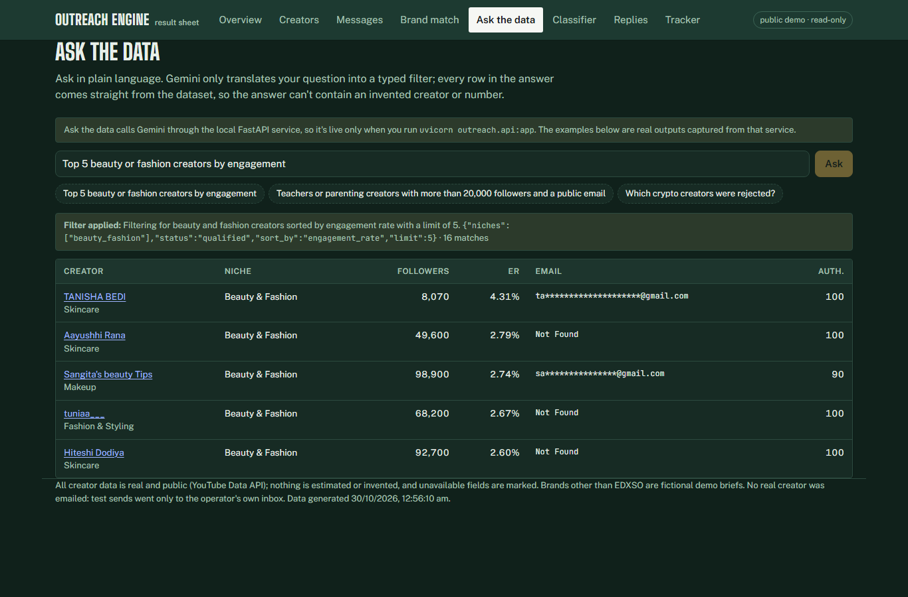
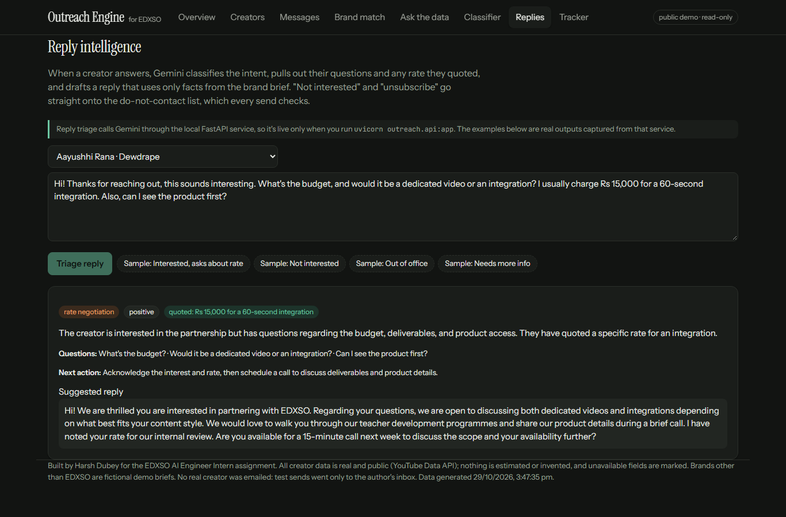
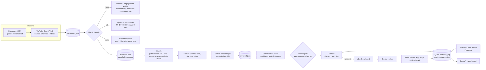

# Creator Outreach Engine

An end-to-end, AI-powered micro-influencer outreach system built on **real YouTube data** across all the niches in the
brief. It discovers creators, filters them with explainable rules plus a **trained and evaluated ML niche classifier** and
an **audience-authenticity score**, enriches each profile with only what the creator published, ranks creators against a
plain-English **brand brief** using embeddings, writes a personalised email and Instagram DM with Gemini, holds anything
doubtful for **human review**, sends through **n8n + Gmail** with crash-safe duplicate protection, **triages replies**, and
schedules **follow-ups**.

**Live demo:** https://edxso-outreach-engine.vercel.app: the results page (merit list, how each result was decided, a live classifier you can type into). The full dashboard is at [/app.html](https://edxso-outreach-engine.vercel.app/app.html). Both are read-only with emails masked.
**Run it locally:** `uvicorn outreach.api:app` → http://localhost:8000 (full interactive mode)
**Run it for your own brand:** self-host it, sign in with Google, write a brand brief, and the autopilot handles discovery to replies. See [Self-hosted autopilot](#self-hosted-autopilot-run-it-for-your-own-brand).



## Results of the test run (all real data, 29 Oct 2026)

| Niche | Brand brief | Discovered | In 5k–100k | Qualified | Published email | Messages approved |
|---|---|---:|---:|---:|---:|---:|
| Education & Parenting | **EDXSO** (real brand) | 749 | 173 | 40 | 8 | 38 |
| Fitness | PulseRoot (demo) | 215 | 68 | 25 | 8 | 25 |
| Lifestyle | Ghar Gully (demo) | 205 | 79 | 24 | 12 | 24 |
| Gaming | LagLess (demo) | 200 | 75 | 19 | 15 | 18 |
| Crypto & Web3 | BlockSchool (demo) | 356 | 90 | 17 | 10 | 17 |
| Beauty & Fashion | Dewdrape (demo) | 213 | 74 | 16 | 7 | 16 |
| Technology | Voltnest (demo) | 331 | 97 | 12 | 3 | 12 |
| Fintech | PaisaPilot (demo) | 404 | 87 | 8 | 3 | 8 |
| **Total** | 8 briefs | **2,673 (2,629 unique)** | **743** | **161** | **66** | **158 / 161** |

- **Sending:**
  - 65 emails simulated (dry-run), each with an `.eml` preview.
  - 2 real emails sent through **n8n + Gmail** to the operator's test inbox (Education and Gaming), each with its Gmail message id logged.
  - 160 Instagram DMs queued for manual sending.
  - A second run skipped every creator already contacted.
- **Rejection reasons:** every rejected profile lists them. The most common are follower count, then niche relevance, then engagement.
- **Classifier:** 89.4% accuracy on held-out labels ([MODEL_CARD.md](MODEL_CARD.md)).
- **Variety:** all six collaboration angles from the brief appear across the batch.

### Screenshots

| | |
|---|---|
|  Every profile with pass/fail and the reason for each rule |  Email + DM per creator, word counts, signals used |
|  In-browser classifier, experiments, confusion matrix |  One brief ranks creators across all niches |
|  Natural-language questions → typed filter → real rows |  Reply intent, quoted rate, drafted response |

## What goes beyond the brief

| Area | The brief asks for | What this system does |
|---|---|---|
| Niches | at least one complete filtering category | **8 niche campaigns** (all 9 listed niches, Beauty + Fashion combined as in the brief's example), one shared engine, each defined by a JSON brand brief |
| Filtering | rule-based pass/fail with reasons | rules **+ ML classifier + authenticity score**, every check recorded with a plain-English reason (the "audit trail") |
| Classification | meaningful categories | a **scikit-learn model trained on this project's own data**, benchmarked against baselines on an independently labelled held-out set ([MODEL_CARD.md](MODEL_CARD.md)) |
| Data quality | no fake metrics | engagement from real video stats; **fake-engagement screening**; emails only where published; private fields marked unavailable |
| Personalisation | dynamic, not one template | creator-specific signals, a **validator** that rejects generic or invented content, a running "don't reuse these phrasings" list, and angle spread across the batch |
| Review | (in the suggested flow) | **dashboard review queue**: edit, re-validate, approve |
| Sending | send/simulate, log, no duplicates | **write-ahead log**, duplicate blocking by creator *and* inbox, **no blind retries**, do-not-contact list, test mode that redirects to the operator |
| Tracking | basic outreach log | log + **reply intelligence** (intent, quoted rate, drafted response) + **follow-up sequence** |
| Extra | | **brand-brief engine** (semantic search across all niches), **"Ask the data"** chat, **FastAPI** model serving, **public dashboard** |

## Architecture



## How each stage works

### 1. Discovery (`outreach/discover.py`)
- Each campaign (`campaigns/*.json`, merged over `campaigns/_defaults.json`) lists 6–20 long-tail search queries. The search is limited to India, English-language results and videos from the past year.
- The system searches **videos**, not channels, so it finds creators who are actively posting on the topic now.
- `channels.list` returns subscribers, country, description, keywords, topic categories and the `madeForKids` flag.
- For channels near the 5k–100k range, it pulls the last 12 uploads (`playlistItems` + `videos.list`).
- **Engagement rate** = (likes + comments) / views over uploads at least 3 days old. Videos with hidden likes are excluded rather than counted as zero.
- It's quota-aware: every API response is cached on disk, so re-runs cost no quota and a stopped run resumes where it left off.

### 2. Filtering & classification (`outreach/classify.py`, `outreach/ml.py`, `outreach/authenticity.py`)
Every rule writes `{passed, detail}`. A creator qualifies only if all hard checks pass. A rejected creator lists every check it failed, for example *"classifier says gaming (0.81), technology only 0.07"*.

| Check | Rule (per campaign, overridable) |
|---|---|
| Follower range | 5,000–100,000; hidden counts are rejected |
| Engagement | ≥ 1.5% (gaming ≥ 2%), over at least 3 sampled videos |
| Activity | last upload ≤ 120 days ago |
| Niche relevance (rules) | keyword evidence ≥ 6 for the best segment; judged only when video titles were fetched |
| **Niche classifier (ML)** | hybrid model gives the campaign's niche probability ≥ 0.35 |
| **Audience authenticity** | score ≥ 40 / 100 (see below) |
| Not made for kids | `madeForKids` channels are rejected (their audience is children, not buyers) |
| Brand safety | shared blocklist plus niche extras (crypto: signals, airdrops, presales; fintech: "intraday tips", "double your money") |
| Individual creator | rejects names that mark an institution or media brand |

**Segments:** each niche has 4–6 brand-fit segments with their own keywords and weights (for example Teachers & Educators, School Leaders, Parents & Family). A creator's segment is the one with the strongest weighted evidence.

**Audience authenticity (0–100):** calculated from public stats, so no private analytics are needed.
- Low reach: the median video reaches under 1% (heavy penalty) or under 3% of subscribers.
- A like rate more than 4× the niche median.
- Fewer than 4 comments per 1,000 likes.
- One viral outlier hiding a low typical view count.

Each signal leaves a human-readable flag. The hard cut is deliberately conservative; flags mainly lower the ranking.

**Fit score:** ranks the shortlist. Weights: keyword relevance 25, ML confidence 15, engagement 20, reach 10, authenticity 10, segment weight 10, India-based 10.

### 3. ML niche classifier — see [MODEL_CARD.md](MODEL_CARD.md)
- **Weak supervision:** a channel's label is the one niche whose searches found it, kept only when its own text has keyword evidence for that niche.
- **Independent evaluation:** Gemini (temperature 0) labels a stratified random sample of 200 channels and may answer "other". These channels are held out from training.
- **Experiments:** keyword rules vs TF-IDF + logistic regression vs a **hybrid** (model probabilities averaged with the rule distribution), plus a Gemini-embedding variant when quota allows. It reports cross-validation, held-out accuracy, macro-F1, a confusion matrix and the abstain-threshold trade-off.
- **Result:** an 831-channel corpus, 199 channels held out for Gemini gold labels, and 385 weakly labelled channels for training. **The hybrid reaches 89.4% held-out accuracy (macro-F1 0.853) and commits to a niche on 97.5% of channels.** TF-IDF + LR alone gets 82.4% (0.812) and the hand-written keyword rules 80.9% (0.752). The model learns beyond the keyword lists; the rules steady the niches with little data.
- The model is exported to JSON, and `dashboard/model.js` reproduces scikit-learn's maths exactly, so the public page classifies text in the browser.

### 4. Enrichment (`outreach/enrich.py`, `outreach/match.py`)
- **Contact email:** only emails the creator published, checked in this order:
  1. The channel description, including de-obfuscating `name [at] site [dot] com`.
  2. Their own website (homepage + `/contact`, fetched only where robots.txt allows).
  3. A *business-intent* line in a video description. Institutional domains (`.ac.in`, `.edu`, `.gov`) are dropped.

  If none of these turns up an email, the field is `Not Found`. YouTube's CAPTCHA-protected email button is never automated.
- **Links:** Instagram, TikTok, X, Facebook, LinkedIn and website.
- **Themes, tone, inferred audience and standout video:** Gemini reads the real description and titles. The standout video must exactly match a real title.
- **Audience age and gender:** `Not Available (private YouTube Analytics data)`. The creator's country is reported separately and labelled as such.
- **Semantic brand fit:** Gemini embeddings of the brand brief and the creator's content, ranked within the shortlist. `final_score = 0.75 × fit + 0.25 × brand fit`.

### 5. AI personalisation & review (`outreach/personalize.py`)
- **System prompt:** the brand's real offer, the brief's six collaboration angles, word limits, and strict rules: no invented facts, numbers, past collaborations or placeholders.
- **User prompt:** this creator's own segment, themes, tone, standout and latest video, and country, plus a segment-specific angle hint.
- **Variety:** a running list of phrasings already used and a count of angles already pitched, so the batch doesn't collapse into one template.
- **Validator:** email 60–90 words and DM 15–30; greets the creator by a name taken from their channel name; shares real words with their content; no follower or engagement numbers; no generic DM opener ("Hello!", "Loved your…"); a valid angle.

Failures go back to the model with the exact violations, for up to 3 attempts. Anything still failing is `needs_review`. In the dashboard a human can edit a message, and the edit is re-validated with the same rules.

### 6. Sending (`outreach/sender.py`, `n8n/`)
- **Modes:**
  - `dry-run` (default): `.eml` previews.
  - `test`: really sends, but redirects to `TEST_RECIPIENT`, with the intended address in the subject.
  - `live`: requires `--confirm-live` and isn't available from the UI.
- **Transport:** SMTP, or the **n8n workflow "EDXSO Outreach Sender"** (webhook → Gmail → per-email status back). The webhook is protected by a secret token header.
- **Duplicate safety:**
  - A `sending` row is written before each email goes out (write-ahead).
  - Partial `UNIQUE` indexes cover both creator and inbox.
  - The n8n call is **never retried**: if there's no reply, the email is marked `unconfirmed`, not `failed`.
- **Do-not-contact list:** checked before every send in every campaign.
- **Instagram DMs:** Meta doesn't allow automated cold DMs, so approved DMs are queued `dm_queued_manual` with the creator's Instagram link when they published one. A person sends them and runs `mark-dm`.

### 7. Replies & follow-ups (`outreach/replies.py`, n8n "EDXSO Reply Triage")
- **Reply triage:**
  - Gemini classifies intent (interested, needs more info, rate negotiation, not interested, out of office, unsubscribe).
  - It extracts the creator's questions and any rate they quoted, and drafts a reply that uses only facts from the brief.
  - Not-interested and unsubscribe replies go on the suppression list.
- **In n8n:** a Gmail trigger watches for replies to outreach, Gemini triages them, and the suggested reply is saved as a **Gmail draft in the same thread** for a human to send. Nothing is sent automatically.
- **Follow-ups:** `python -m outreach followup --days 4` sends one follow-up per creator when it's due. It never goes to creators who replied or are suppressed, and never twice.

### 8. API & dashboard (`outreach/api.py`, `dashboard/`)
| Endpoint | What it does |
|---|---|
| `GET /api/data` | everything the dashboard shows |
| `POST /api/classify` | **model serving**: hybrid niche prediction for any text |
| `POST /api/match` | brand-brief → ranked creators across all niches (embeddings) |
| `POST /api/ask` | natural-language question → typed filter (Gemini) → rows from the data (no hallucinated answers) |
| `PATCH /api/campaigns/{id}/messages/{channel}` | human edit + re-validation + approve |
| `POST /api/campaigns/{id}/send` | dry-run or test send (live is CLI-only) |
| `POST /api/replies` | reply triage (+ optional save, which suppresses unsubscribes) |

The dashboard runs in two modes:
- **Live** (local API): edit and approve messages, send, ask, match and triage.
- **Public** (static, on Vercel): everything is precomputed and emails are masked. The classifier still runs live in the browser.

## Setup

```bash
git clone https://github.com/HarshDubey23/edxso-influencer-outreach && cd edxso-influencer-outreach
pip install -r requirements.txt          # scikit-learn, joblib, fastapi, uvicorn (the core pipeline is stdlib-only)
cp .env.example .env                     # YOUTUBE_API_KEY, GEMINI_API_KEY, TEST_RECIPIENT, N8N_WEBHOOK_URL/TOKEN
python -m unittest discover -s tests -v  # offline tests, no keys needed
```

```bash
python -m outreach discover --campaign all     # YouTube discovery for every niche
python -m outreach train                       # train + evaluate the niche classifier
python -m outreach classify --campaign all     # rules + ML + authenticity
python -m outreach enrich --campaign all       # emails, links, themes, semantic brand fit
python -m outreach personalize --campaign all  # Gemini email + DM with validation
python -m outreach send --campaign all         # dry-run (add --mode test --via n8n to really send to yourself)
python -m outreach followup --campaign all --days 4
python -m outreach demo                        # capture ask/match/reply examples for the public page
python -m outreach site                        # combined exports + static site in site/
uvicorn outreach.api:app                       # API + dashboard on http://localhost:8000
```

**New niche or brand:** add `campaigns/<name>.json` (queries, segments with keywords and angle hints, brand brief, optional overrides). The code doesn't change.

## Self-hosted autopilot (run it for your own brand)

The same engine, packaged so any brand can run outreach from its own Gmail without touching the CLI.
The **Control room** (`/control.html`, behind a password) is where it is driven:

1. **Connect Gmail.** "Sign in with Google" grants two scopes: `gmail.compose` (send, save drafts) and `gmail.readonly`
   (read replies in threads the app started). The refresh token is stored encrypted (Fernet, key derived from `SECRET_KEY`).
   No app password is involved.
2. **Write a brand brief** in plain English. Gemini turns it into a campaign (niche, search queries, audience segments),
   which you can edit before saving.
3. **Turn on the autopilot.** Every ~5 minutes (with jitter) it:
   - refreshes the pipeline once a day (discover → filter → enrich → write), keeping messages already written;
   - reads replies in its own threads, classifies intent, honours opt-outs, and saves a suggested answer as a **Gmail draft**
     (it never replies on its own; bounce notices are logged, not triaged);
   - sends **at most one** email or follow-up per tick.

**Guardrails** (all editable in the Control room):

| Guardrail | Default |
|---|---|
| Live sending | **off**: every email is redirected to your own inbox with a `[TEST -> creator]` subject |
| Live sending requires | a postal address in the footer (CAN-SPAM) and a typed confirmation |
| Daily cap | 20 emails |
| Sending window | 10:00–18:00 in your time zone |
| Human review | the first 10 emails go out only after you approve them in the dashboard |
| Opt-out | `List-Unsubscribe` header + one-click link in every email; opted-out addresses are never contacted again |
| Duplicates | write-ahead log: one email per creator and inbox, never resent after a crash |

Everything was verified against real Gmail: OAuth connect, send, unsubscribe link, reply read-back, triage and draft.

### Google OAuth client (one time, ~5 minutes)

1. [Google Cloud Console](https://console.cloud.google.com) → new project → **APIs & Services → Library** → enable **Gmail API**.
2. **OAuth consent screen** → External → add the two scopes above → add your Gmail address under **Test users**
   (in "Testing" mode only listed users can sign in; publish the app to lift that).
3. **Credentials → Create OAuth client ID → Web application** → authorised redirect URI:
   `<BASE_URL>/auth/google/callback` (locally `http://localhost:8000/auth/google/callback`).
4. Put the client ID and secret in `.env` as `GOOGLE_CLIENT_ID` / `GOOGLE_CLIENT_SECRET`.

### Run it

Locally:

```bash
cp .env.example .env    # YOUTUBE_API_KEY, GEMINI_API_KEY, SECRET_KEY, ADMIN_PASSWORD, GOOGLE_CLIENT_ID/SECRET, WORKSPACE_ONLY=1
uvicorn outreach.api:app
```

Docker:

```bash
docker build -t outreach-engine .
docker run -p 8000:8000 --env-file .env -v outreach-data:/app/data outreach-engine
```

Render: `render.yaml` is a one-click blueprint (Docker web service + 1 GB disk for `data/`). Set `BASE_URL` to the
service URL and add the same `/auth/google/callback` redirect URI to the OAuth client.

`data/` holds the settings, encrypted token, outreach log and stage files, so it must be on a persistent volume.
With `WORKSPACE_ONLY=1` the install shows only your own campaign, not the bundled demo niches.

## Deliverables

| File | Contents |
|---|---|
| `output/ALL_influencers_dataset.csv` | every discovered profile in every niche: name, platform, followers, engagement, niche, ML niche, authenticity, email, URL, themes, **status + reasons** |
| `output/ALL_shortlist_enriched.csv` | qualified creators with every mandatory and optional enrichment field |
| `output/ALL_personalized_messages.csv` | email subject + pitch, DM, angle, signals used, word counts, review status |
| `output/ALL_outreach_tracker.csv` | influencer, email, message generated, sent, date, status, mode, transport, error |
| `output/<campaign>/` | the same four files per niche |
| `MODEL_CARD.md`, `models/metrics.json` | classifier evaluation |
| `n8n/*.json` | importable sender and reply-triage workflows |

## Scaling to 500+ creators
- **More discovery:** add queries or set `pages_per_query`. A query costs 100 YouTube quota units, so about 90 pages fit in the free daily quota. Video fetches run 8 in parallel.
- **Resumable stages:** every stage reads and writes JSON, and every API or LLM call is cached, so a crash or a quota stop resumes for free.
- **Model upkeep:** the classifier retrains in seconds as the corpus grows. Creator embeddings are computed once and stored.
- **Storage:** SQLite is fine at this size. The schema maps directly onto Postgres if several workers send at once.
- **Sending pace:** `--limit` caps daily sends for inbox warm-up.

## Limitations (stated honestly)
- **Email coverage is low.** Most creators keep their business email behind YouTube's CAPTCHA button or in an Instagram bio. Getting past either would break the platform's terms, so those creators are `Not Found`. A paid enrichment API or a manual check would close the gap.
- **Audience age, gender and geography** are private analytics. They come from a creator's media kit after first contact.
- **YouTube is the data source.** Instagram and TikTok handles are captured when published, but those platforms aren't scraped.
- **Classifier labels:** the training labels are weak and the evaluation judge is an LLM, not a human, so the accuracy is indicative. Hindi script is ignored by the tokenizer.
- **Rounded counts:** YouTube rounds subscriber counts to 3 significant figures.
- **Free-tier limits:** Gemini's free tier caps each model at about 500 requests a day and rate-limits embeddings.
  - Messages were written by `gemini-3.5-flash-lite`. After it hit its daily cap, the last niche used `gemini-3.5-flash` and `gemini-3.1-flash-lite`, and each message records its model.
  - When embeddings are limited, brand-fit ranking falls back to the fit score and the run says so.
  - The niche classifier's Gemini-embedding experiment couldn't run because of the same limit.
- **Brands:** apart from EDXSO, the brands are **fictional demo briefs**. No real creator was emailed: test sends went only to the operator's inbox.
